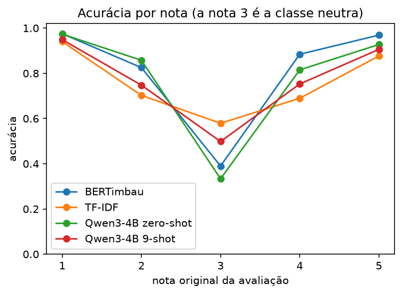
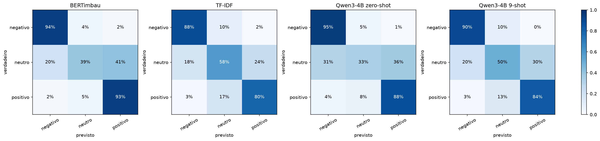
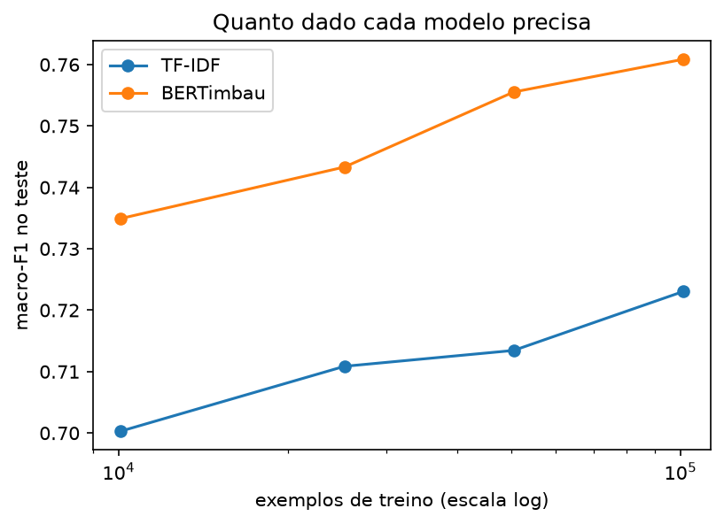

# Sentimento em português: TF-IDF, BERTimbau e LLM

[](https://github.com/arthurvelloso/sentimento-pt/actions/workflows/ci.yml)

Classificação de sentimento (negativo, neutro, positivo) em avaliações de
produtos em português, com três abordagens comparadas pelo **mesmo avaliador**:
um baseline TF-IDF, o BERTimbau ajustado e um LLM. Comparação em qualidade,
latência e custo.

> **Status:** em construção. Dados, avaliador único, baseline TF-IDF, BERTimbau, LLM em
> zero e few-shot, análise de erros e ablação de dados estão prontos. Em andamento: LLM
> ajustado com QLoRA, custo por mil previsões, model card e demo.

## Resultado

Conjunto de teste (12.618 avaliações). Todos os modelos foram medidos nas mesmas avaliações:

| Modelo | Macro-F1 | Acurácia | F1 negativo / neutro / positivo | Latência p50 / p95 |
| --- | --- | --- | --- | --- |
| TF-IDF + regressão logística | 0,723 | 79,4% | 0,864 / 0,442 / 0,863 | 1,5 / 2,3 ms (CPU) |
| **BERTimbau ajustado** | **0,761** | **86,8%** | 0,904 / 0,456 / 0,923 | 12,1 / 16,1 ms (GPU T4) |
| Qwen3-4B, zero-shot | 0,711 | 83,0% | 0,862 / 0,369 / 0,901 | 43 / 56 ms (GPU RTX PRO 6000) |
| Qwen3-4B, 9 exemplos | 0,729 | 81,5% | 0,875 / 0,426 / 0,885 | 56 / 69 ms (GPU RTX PRO 6000) |
| LLM ajustado com QLoRA | em andamento | | | |

O que as diferenças valem (intervalos de 95% por bootstrap pareado sobre o teste):

- **O BERTimbau é o melhor.** +3,8 pontos de macro-F1 sobre o TF-IDF (de +3,0 a +4,7) e
  +3,2 sobre o Qwen3-4B com 9 exemplos (de +2,3 a +4,2).
- **O Qwen3-4B sem exemplos fica abaixo do TF-IDF** em macro-F1: −1,2 ponto (de −2,2 a −0,3).
  Ele acerta mais (83,0% contra 79,4%) porque acerta mais as avaliações positivas, que são
  62% do teste.
- **Com 9 exemplos, o Qwen3-4B empata com o TF-IDF.** A diferença é de +0,6 ponto, com
  intervalo de −0,3 a +1,4, que inclui zero.
- **A classe neutra é o limite de todos os modelos.** O melhor F1 nela é 0,456.

Esses intervalos medem só a variação da amostra de teste. Cada modelo foi treinado com uma
seed, então a variação entre treinos não está incluída.

**As latências não são comparáveis entre si.** Foram medidas em três máquinas (CPU Apple M5,
GPU T4 e GPU NVIDIA RTX PRO 6000 Blackwell, as duas últimas no Colab), com uma avaliação por
chamada. As métricas de qualidade não dependem da máquina. O custo por mil previsões ainda não
foi medido.

Resultados completos em [`results/`](results/): um JSON por modelo (métricas e matriz de
confusão) e [`analysis.json`](results/analysis.json) (comparação, erros por nota e intervalos).

## Dados

[B2W-Reviews01](https://github.com/americanas-tech/b2w-reviews01): 132.373
avaliações de clientes de uma loja online brasileira, entre janeiro e maio de
2018. Fixado por commit e verificado por SHA-256.

**Rótulo** a partir da nota: 1-2 → negativo · 3 → neutro · 4-5 → positivo.
Usa-se só o texto da avaliação (`review_text`); a coluna `recommend_to_a_friend`
não entra, para não vazar o rótulo.

**Limpeza, antes do split.** Duplicatas entre treino e teste inflam as métricas.

| Passo | Linhas |
| --- | --- |
| Avaliações no arquivo | 132.373 |
| Sem texto | −3.275 |
| Só pontuação ou emoji (vazio após normalizar) | −106 |
| Mesmo texto com notas diferentes (rótulo ambíguo) | −188 |
| Mesmo texto e mesma nota (fica a primeira cópia) | −2.624 |
| **Avaliações usadas** | **126.180** |

Duas avaliações são "o mesmo texto" se forem iguais após minúsculas, sem
acentos e sem pontuação ("Ótimo produto!" = "otimo produto").

**Split** estratificado, seed 42: treino 100.944 · validação 12.618 · teste 12.618.
Todos têm a mesma distribuição: 25,8% negativo · 12,5% neutro · 61,7% positivo.
O manifesto (`splits/manifest.csv`, só ids de linha) é versionado; os textos não, com a
pequena exceção descrita em Licença.

## Como reproduzir

Python 3.12+.

```bash
python -m venv .venv && source .venv/bin/activate
pip install -r requirements.txt

make test       # testes com dados sintéticos, não baixam nada
make data       # baixa o CSV (49 MB), limpa e confere o manifesto do split
make baseline   # treina, escolhe na validação, avalia no teste, grava results/tfidf.json
make ablation-tfidf  # TF-IDF com 10/25/50/100% do treino + previsões por exemplo (~1 min)
make analysis        # erros por nota e por tamanho, matrizes de confusão, amostra de erros
```

O `make baseline` é lento: a grade tem 8 regressões logísticas sobre ~265 mil
features, o que levou algumas dezenas de minutos num Mac (Apple M5). O `make ablation-tfidf`
reaproveita a melhor combinação da grade e leva cerca de 1 minuto.

As partes que precisam de GPU (previsões do BERTimbau, ablação de dados do BERTimbau e o
LLM) rodam em [`notebooks/experimentos_gpu.ipynb`](notebooks/experimentos_gpu.ipynb), que devolve um `.zip`
com os arquivos de `results/`. Depois disso, `python -m src.ablation_bert` (CPU) junta a curva
do BERTimbau e `make analysis` refaz a comparação com todos os modelos.

## Fine-tuning do BERTimbau

[`neuralmind/bert-base-portuguese-cased`](https://huggingface.co/neuralmind/bert-base-portuguese-cased)
ajustado com `src/train_bert.py`, sobre os mesmos splits e o mesmo avaliador do
baseline. O treino precisa de GPU: neste Mac (MPS) foram medidos cerca de 1,6 s por passo
de 32 exemplos, o que dá, por extrapolação, algo como 4 horas para as 3 épocas.
No Kaggle ou no Colab, use o notebook
[`notebooks/bertimbau_train.ipynb`](notebooks/bertimbau_train.ipynb).

| Escolha | Valor | Por quê |
| --- | --- | --- |
| Comprimento máximo | percentil 95 dos tamanhos em tokens, arredondado a múltiplo de 8 | padding até 512 desperdiça memória; truncar 5% dos textos custa pouco |
| Learning rate | 3e-5 (faixa usual do BERT: 2e-5 a 5e-5) | |
| Épocas / batch | 3 / 32 | |
| Warmup | 10% dos passos, depois decaimento linear | |
| Precisão | fp16 em GPU CUDA | |
| Melhor checkpoint | época com maior **macro-F1 na validação** | mesma métrica do baseline |

**Treino completo** (100.944 exemplos, seed 42), em 23,6 minutos numa Tesla T4:

| Época | Macro-F1 (val) | Acurácia (val) | Loss (val) |
| --- | --- | --- | --- |
| 1 | 0,744 | 86,3% | 0,367 |
| **2** (escolhida) | **0,747** | 86,1% | 0,379 |
| 3 | 0,745 | 85,9% | 0,419 |

O macro-F1 praticamente não muda entre as épocas (diferença de 0,003, provavelmente
dentro do ruído de uma seed), enquanto a loss de validação sobe: o modelo começa a
sobreajustar depois da primeira época. No teste, o checkpoint da época 2 dá macro-F1
de 0,761 e acurácia de 86,8%.

O teste é avaliado uma única vez, com o melhor checkpoint. Um treino parcial
(`--train-subset`) é marcado com `is_subset: true` no JSON, para não ser
confundido com o resultado final. O modelo vai para um repositório **privado** no
Hub a cada época (`--hub-repo`), para uma sessão de GPU que caia não perder o treino.

```bash
pip install -r requirements-train.txt   # e o torch, se não estiver instalado
python -m src.train_bert --hub-repo SEU_USUARIO/bertimbau-sentimento-b2w
# outras seeds:  --seed 1  (grava em results/bertimbau_seed1.json)
```

## Como o baseline foi escolhido

TF-IDF de palavras (1-2 gramas) junto com n-gramas de caracteres (2-5), que pegam
erros de digitação e variações comuns em avaliações. Regressão logística com
`C` e `class_weight` escolhidos na **validação**, por macro-F1:

| C | `class_weight` | Macro-F1 (val) | Acurácia (val) |
| --- | --- | --- | --- |
| **0,25** | **balanced** | **0,717** | 79,2% |
| 0,25 | nenhum | 0,688 | 84,3% |
| 1 | balanced | 0,715 | 80,1% |
| 1 | nenhum | 0,698 | 84,0% |
| 4 | balanced | 0,708 | 80,6% |
| 4 | nenhum | 0,697 | 83,3% |
| 16 | balanced | 0,699 | 80,6% |
| 16 | nenhum | 0,690 | 82,5% |

`class_weight="balanced"` ganha cerca de 2 a 3 pontos de macro-F1 e perde cerca
de 4 pontos de acurácia: troca acertos na classe majoritária por acertos na
neutra. Por isso a métrica principal é macro-F1 e não acurácia.

## LLM: Qwen3-4B em zero-shot e few-shot

[`Qwen/Qwen3-4B`](https://huggingface.co/Qwen/Qwen3-4B), licença Apache 2.0, em fp16, com o
modo de raciocínio desligado e decodificação gulosa (sem sorteio). O modelo responde com uma
palavra e um parser a converte em classe. Respostas que não sejam um rótulo contariam como
erro, mas **nenhuma das 25.236 respostas foi inválida** (duas rodadas de 12.618).

- **Prompt:** um só, versão `v1` ([`src/llm_classify.py`](src/llm_classify.py)), que descreve as
  três classes pela nota (1-2, 3 e 4-5). Não foi ajustado: a `v1` foi usada como escrita, e as
  rodadas na validação (macro-F1 0,696 no zero-shot e 0,716 no few-shot) serviram só para
  conferir que o formato funcionava.
- **Few-shot:** 9 exemplos (3 por classe), sorteados do treino com seed 42, só textos de até
  300 caracteres, em ordem misturada.
- **Tempo:** o teste inteiro levou 121 s (zero-shot) e 353 s (9 exemplos) na RTX PRO 6000.
  Na T4, não medido.
- **Correção registrada:** o código previa avaliar subconjuntos (600 na validação e 3.000
  no teste), mas um erro no tratamento da flag `--max-eval` fez a rodada avaliar tudo. O erro
  foi corrigido e há um teste de regressão. Os resultados valem para o conjunto inteiro, que é
  a comparação mais direta com os outros modelos.

## Onde os modelos erram

Análise sobre o teste (`make analysis`), juntando a **nota original** às previsões. O rótulo de
3 classes esconde isto: a acurácia por nota, em cada modelo.

| Nota | Avaliações | BERTimbau | TF-IDF | Qwen3-4B zero-shot | Qwen3-4B 9 exemplos |
| --- | --- | --- | --- | --- | --- |
| 1 | 2.483 | 97,5% | 94,0% | 97,3% | 94,9% |
| 2 | 773 | 82,5% | 70,2% | 85,8% | 74,8% |
| **3 (neutro)** | 1.577 | **39,0%** | 57,9% | 33,4% | 49,8% |
| 4 | 3.173 | 88,4% | 69,0% | 81,5% | 75,3% |
| 5 | 4.612 | 96,9% | 87,7% | 92,7% | 90,6% |




- **Todos erram nas notas vizinhas ao neutro** (2, 3 e 4) e vão bem nas extremas.
- **O ganho do BERTimbau vem de negativo e positivo, não do neutro.** O F1 dele em negativo e
  positivo (0,904 e 0,923) é bem maior que o do TF-IDF (0,864 e 0,863), mas no neutro a
  diferença é pequena (0,456 contra 0,442). Na nota 3, o BERTimbau acerta só 39%: 41% vão para
  positivo e 20% para negativo. Uma hipótese, ainda não testada, é que isso vem de ele ter
  sido treinado sem pesos de classe, enquanto o TF-IDF usou `class_weight="balanced"`.
- **Os exemplos no prompt deslocam o LLM para o neutro.** A nota 3 passa de 33% para 50% de
  acerto, mas 1.018 avaliações positivas (de 7.785) viram "neutro", contra 595 no zero-shot.
  Por isso o macro-F1 sobe 1,8 ponto e a acurácia cai 1,5.
- **Textos de 1 a 5 palavras** (só 80 avaliações): o BERTimbau acerta 81%, o TF-IDF 75% e os
  dois LLMs 66% a 68%. A amostra é pequena.
- **Os modelos erram juntos.** Dos 12.618 exemplos, BERTimbau e TF-IDF acertam os dois em
  9.569 (75,8%); só o BERTimbau acerta 1.380 e só o TF-IDF acerta 453. Os dois erram em 1.216, e
  em 1.082 deles (89%) erram do mesmo jeito. Quando dois modelos tão diferentes cometem o mesmo
  erro, é sinal de que o problema pode estar no rótulo ou no texto, e não em cada modelo.

## Os 40 erros do BERTimbau, lidos à mão

Amostra de 40 erros do teste, sorteada com seed 42 e proporcional ao tipo de erro (classe
verdadeira → prevista), classificada em categorias:

| Categoria | Erros | O que é |
| --- | --- | --- |
| rótulo duvidoso | 18 | o texto contradiz a nota (elogio só com nota 3, reclamação com nota 4 ou 5); a previsão do modelo é defensável |
| avaliação mista | 12 | elogio e queixa no mesmo texto; mais de uma classe é razoável |
| erro claro do modelo | 5 | texto sem ambiguidade aparente, e o modelo errou |
| sentimento implícito | 2 | reclamação descrita por fatos, sem palavras de opinião |
| texto pouco informativo | 2 | sem opinião (por exemplo, informação técnica) |
| negação | 1 | "não tive nenhum problema" lido como neutro |
| ironia | 0 | |

Exemplos (trechos do B2W-Reviews01, ver Licença): nota 3 prevista como positivo, _"Gostei do
produto, ele atendeu as minhas expectativas."_ (rótulo duvidoso); nota 3 prevista como negativo,
_"poltrona pequena e frágil, quebra um galho, mas ñ compraria de novo"_ (avaliação mista); nota 4
prevista como neutro, _"Gostei do produto e o preço está acessível, agora queria saber se essa
TV é 110 ou 220 v"_ (erro claro).

**Trinta dos 40 erros (75%) são de rótulo duvidoso ou de avaliação mista**: o texto não decide
entre as classes, ou contradiz a nota. Só 8 (20%) parecem falhas do modelo (erro claro,
sentimento implícito e negação). Isso combina com a concordância entre modelos acima: boa parte
do "erro" é um limite do rótulo derivado da nota.

**Como ler isto com cautela.** A classificação inicial foi feita por um único anotador, é
subjetiva e ainda não foi revisada por outra pessoa. Com
40 casos, cada proporção tem margem de uns ±15 pontos. A classificação, sem os textos, está em
[`results/categorias_erros_bertimbau.csv`](results/categorias_erros_bertimbau.csv); os textos
ficam fora do git por causa da licença.

## Quanto dado cada modelo precisa

Mesma configuração de cada modelo, treinada com frações do treino (macro-F1; teste lido uma vez
por tamanho, só para descrever a tendência, sem escolher nada com ele):

| Exemplos de treino | TF-IDF (val) | TF-IDF (teste) | BERTimbau (val) | BERTimbau (teste) |
| --- | --- | --- | --- | --- |
| 10.094 (10%) | 0,696 | 0,700 | 0,737 | 0,735 |
| 25.236 (25%) | 0,706 | 0,711 | 0,743 | 0,743 |
| 50.472 (50%) | 0,710 | 0,713 | 0,749 | 0,756 |
| 100.944 (100%) | 0,717 | 0,723 | 0,747 | 0,761 |



- **A distância entre os modelos é de 3 a 4 pontos em todos os tamanhos** (3,5; 3,2; 4,2 e 3,8
  no teste). Mais dado ajuda pouco os dois: de 10 mil para 100 mil exemplos, o TF-IDF ganha 2,3
  pontos e o BERTimbau 2,6.
- **O BERTimbau com 10% dos dados (0,735) já fica acima do TF-IDF com 100% (0,723).** A
  diferença é pequena e não calculei intervalo, porque as previsões do BERTimbau com 10% não
  foram guardadas.
- **O ponto de 100% do TF-IDF reproduz o baseline** (macro-F1 de teste idêntico, 0,7230), o que
  confere o pipeline.

Ressalvas: com 10% e 25% dos dados a melhor época do BERTimbau foi a última (a 3ª), então ele
ainda estava melhorando e esses dois pontos podem estar subestimados. O treino principal rodou
numa T4 e a ablação numa RTX PRO 6000, então os tempos de treino não são comparáveis. É uma
seed por ponto.

## Decisões

- **Macro-F1 como métrica principal.** As classes são desbalanceadas (62% positivo),
  então a acurácia premia quem ignora a classe neutra.
- **Um avaliador para todos os modelos** (`src/evaluate.py`): mesmas métricas, mesmo
  teste, mesma forma de medir latência. A comparação não muda por diferença de código.
- **Limpeza antes do split**, com SHA-256 do arquivo e manifesto versionado: o split é
  auditável e reproduzível sem publicar os textos.
- **Teste tocado uma vez**, depois de fixar tudo na validação.
- **BERTimbau sem pesos de classe na loss.** É a receita padrão, mas o baseline ganhou
  com `class_weight="balanced"`, então a comparação favorece um pouco o TF-IDF na classe
  neutra. Uma loss ponderada fica como ablação.

## Limitações

- **A melhor combinação está na borda da grade.** O melhor `C` (0,25) é o menor
  valor testado e o macro-F1 cai a cada aumento de `C`; um `C` menor pode render
  um pouco mais. O baseline pode estar levemente subestimado.
- **Vazamento por produto.** O split é por avaliação, então avaliações do mesmo
  produto aparecem em treino e teste. Em produção, produtos novos tendem a ir pior.
- **Quase-duplicatas "fuzzy" não são tratadas**, só textos idênticos após normalizar.
- **Rótulo por nota é uma aproximação.** Uma nota 4 pode vir com texto neutro, e é
  parte do que a classe neutra tem de difícil.
- **Um domínio e um período:** e-commerce brasileiro, jan-mai de 2018. Não há
  garantia de que generaliza para outros textos.
- **Uma seed e um split.** Não há intervalo de confiança. O fine-tuning de BERT
  varia entre seeds, então a diferença de 3,8 pontos de macro-F1 sobre o TF-IDF
  ainda não tem a variação do BERT medida.
- **A CI não treina o BERT.** Ela roda sem `torch` (leve), então os testes que treinam um
  BERT minúsculo são pulados lá e rodam só localmente (34 testes com torch, 31 sem).
- **O modelo no Hub foi verificado:** baixado do repositório privado, ele reproduziu
  exatamente o macro-F1 do treino (0,7608 no teste e 0,7472 na validação).
- **Uma seed por modelo.** Os intervalos de confiança cobrem só a amostra de teste. O ajuste
  fino de um BERT varia entre seeds, e essa variação não foi medida.
- **Hardware diferente por modelo** (CPU Apple M5, GPU T4 e GPU RTX PRO 6000): latências e
  tempos de treino não são comparáveis entre as linhas.
- **LLM com um só prompt e uma só seleção de exemplos**, sem ajuste. O resultado depende deles,
  e um modelo de 4 bilhões de parâmetros não representa os LLMs maiores.
- **A leitura dos 40 erros é de um anotador só**, subjetiva e ainda não revisada.
- **A análise por nota é descritiva.** Ela mostra onde os modelos erram, não prova a causa
  (por exemplo, a hipótese dos pesos de classe no BERTimbau não foi testada).

## Estrutura

```
.
├── configs/default.yaml   # dados, split, TF-IDF e grade
├── src/
│   ├── data.py            # download, rótulo, limpeza, split, manifesto
│   ├── prepare.py         # make data
│   ├── evaluate.py        # avaliador único (qualidade + latência)
│   ├── baseline_tfidf.py  # make baseline
│   ├── ablation_tfidf.py  # curva de tamanho de dados do TF-IDF + previsões
│   ├── train_bert.py      # fine-tuning do BERTimbau (GPU)
│   ├── predict_bert.py    # previsões por exemplo do BERTimbau (GPU)
│   ├── ablation_bert.py   # agrega a curva de dados do BERTimbau
│   ├── llm_classify.py    # LLM em zero/few-shot (GPU)
│   ├── predictions.py     # formato das previsões por exemplo (sem texto)
│   └── analysis.py        # análise de erros e comparação entre modelos
├── splits/                # manifest.csv (ids por split) e meta.json (contagens)
├── results/               # métricas (.json), previsões (preds_*.csv) e figuras
├── tests/
├── notebooks/bertimbau_train.ipynb  # fine-tuning no Kaggle ou no Colab
├── notebooks/experimentos_gpu.ipynb # previsões, ablação e LLM na GPU
└── requirements-train.txt # transformers e accelerate (fora da CI)
```

## Licença

Código sob licença MIT ([LICENSE](LICENSE)).

Os dados são do **B2W-Reviews01**, licenciado sob
[CC BY-NC-SA 4.0](https://creativecommons.org/licenses/by-nc-sa/4.0/)
(uso não comercial, com atribuição à B2W Digital e compartilhamento pela mesma
licença). O card do dataset no Hugging Face indica CC BY 4.0, o que diverge do
README original; aqui vale a mais restritiva. Modelos treinados nesses dados devem
herdar essa restrição. Referência: Real, Oshiro e Mafra, *B2W-Reviews01: an open
product reviews corpus*, STIL 2019.

O repositório não republica a base. A exceção são trechos curtos de avaliações do B2W-Reviews01
(B2W Digital, CC BY-NC-SA 4.0): os 9 exemplos do prompt few-shot, gravados em
`results/llm_qwen-qwen3-4b_9shot.json` para o resultado ser reproduzível (cerca de 900
caracteres no total), e as três citações da seção sobre os erros. Esses trechos seguem a licença
da base, e não a do código.
